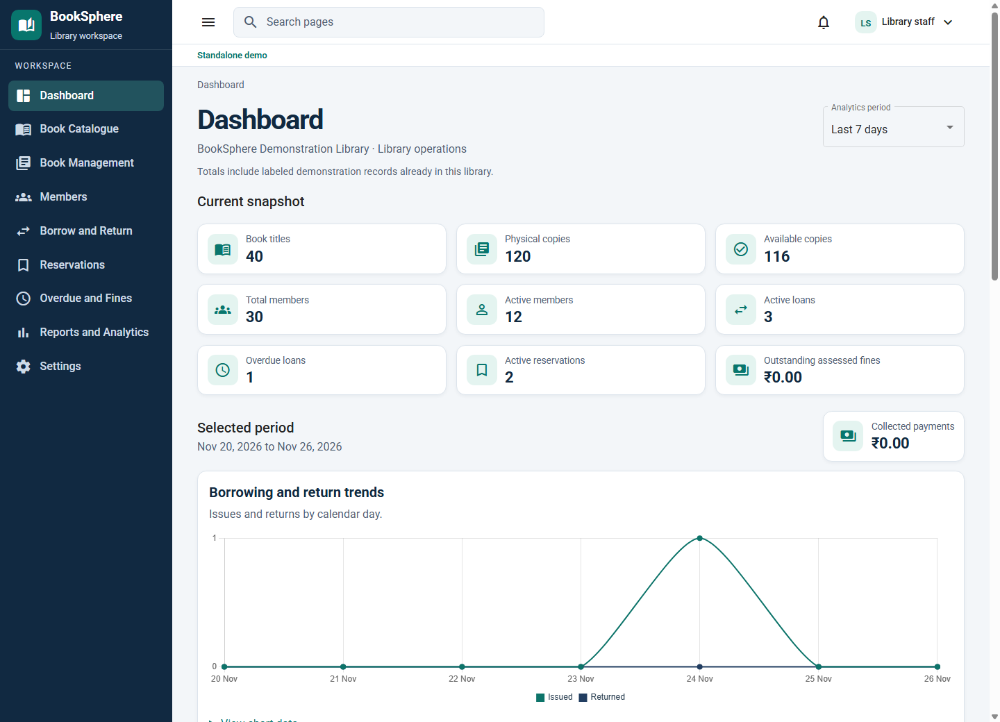

# BookSphere

BookSphere is an independent Angular portfolio project for managing a library catalogue, memberships, circulation, reservations, and fines. It uses fictional holdings, patrons, and payment records to demonstrate how those workflows share the same data. It has no employer affiliation or production usage.

A library desk needs one answer to a practical question: can this member take this copy home? BookSphere brings eligibility, inventory, holds, and outstanding fines into the same workflow. Its goals are to enforce consistent rules across pages, preserve transaction history, and make records easy to search, report, and export.



## Application pages

| Page | Route | What it demonstrates |
| --- | --- | --- |
| Dashboard | `/dashboard` | Current metrics, period trends, accessible chart tables, recent activity, popular titles, and shortcuts |
| Book Catalogue | `/catalogue` | Search, facets, sorting, grid/list views, title details, and availability |
| Book Management | `/books` | Inventory editing, ISBN-10/13 checksum and duplicate checks, and allocation guards |
| Members | `/members` | Registration, profiles, unique membership IDs, status changes, and renewal |
| Borrow and Return | `/circulation` | Checkout, return, loan renewal, and circulation history |
| Reservations | `/reservations` | FIFO waiting lists, ready holds, collection, cancellation, and expiry |
| Overdue and Fines | `/overdue` | Overdue estimates, assessed fines, partial and full payment, and balances |
| Reports | `/reports` | Eight report views, filtering, sorting, CSV export, and native print/Save as PDF |
| Settings | `/settings` | Library profile, hours, borrowing policies, reservation policies, and fine policies |

## Stack and architecture

| Area | Version or implementation |
| --- | --- |
| Angular and Angular CLI | 13.3.12 and 13.3.11 |
| Angular Material and CDK | 13.3.9 |
| TypeScript and RxJS | 4.6.4 and 7.5.7 |
| Project runtime and package manager | Node.js 16.20.2 and npm 8.19.4 |
| Charts and styling | Chart.js 3.9.1 and SCSS |
| Local REST mock | JSON Server 0.17.4 with shared transaction rules |
| Verification | Jasmine, Karma, ChromeHeadless, and an isolated HTTP integration suite |

A shell hosts nine lazy-loaded `NgModule` routes. Reactive Forms validate inputs, and RxJS streams project confirmed records into workspaces, analytics, and reports. Shared business rules govern inventory, circulation, payments, and policies. The [architecture guide](docs/architecture.md) describes the read and write paths.

```text
src/app/
  core/        Domain rules, record validators, seed definitions, analytics
  features/    Nine lazy-loaded workspace modules
  layout/      Navigation shell and data-mode status
  models/      Library, API, analytics, and report contracts
  services/    Reactive state, HTTP client, and storage adapters
  shared/      Reusable Material UI and dialogs
src/assets/    Local Material Icons font and upstream license
src/styles/    SCSS tokens and workspace styles
mock-api/      Loopback server, seed configuration, proxy, and HTTP tests
docs/          Architecture, QA, release notes, and screenshots
```

## Run locally

Prerequisites are Node.js **16.20.2**, npm **8.19.4**, and Chrome for the browser test suite. Run the commands from the project directory. If using nvm-windows with the standard per-user installation, prepend the installed Node version to each PowerShell session. With another installation, activate Node.js 16.20.2 using that installation's version manager.

```powershell
$env:PATH = "$env:APPDATA\nvm\v16.20.2;$env:PATH"
node --version
npm.cmd --version
npm.cmd ci
```

### Standalone demo

```powershell
.\node_modules\.bin\ng.cmd serve --configuration development
```

Open `http://localhost:4200`. This mode uses browser storage and works without running the mock API. Browser data is scoped to the current origin and profile.

### Mock REST API

Run in two PowerShell sessions after activating the same Node version in each:

```powershell
# Terminal 1
npm.cmd run mock-api
```

```powershell
# Terminal 2
.\node_modules\.bin\ng.cmd serve --configuration api
```

Open `http://127.0.0.1:4200`. Angular proxies `/api` to `127.0.0.1:3000`. The API creates its own fictional `mock-api/data/db.json` on first start. It keeps that data separate from browser storage and exposes **Retry read** for failed reads or stale revisions.

| Method | Routes |
| --- | --- |
| GET | `/api/snapshot`, `/api/books`, `/api/members`, `/api/loans`, `/api/reservations`, `/api/fines`, `/api/payments`, `/api/settings`, `/api/activities` |
| POST | Create books, members, loans and reservations. Record returns, renewals, cancellations, payments, and default restoration |
| PUT, PATCH, DELETE | Edit books, members and settings, change member status, and delete eligible books and members |

See the [complete endpoint table and example payloads](mock-api/README.md).

## Business rules and persistence

- A copy is available when it is neither borrowed nor allocated to a ready reservation. Waiting reservations do not reduce inventory.
- Checkout enforces eligibility, the active loan limit, duplicate-loan rules, and ready reservation ownership. Returns promote holds in queue order and assess late fines in the same transaction.
- Loan terms are saved at checkout. The default term is 14 days with up to two seven-day renewals. The default reservation window is three days. Policy changes preserve existing loan terms and hold deadlines.
- Only assessed fines contribute to outstanding balances and borrowing restrictions. Amounts use integer paise, and payments are local demonstration entries.
- Standalone circulation stores a versioned snapshot at `booksphere.circulation.v2`, alongside separate member storage. Earlier migrations preserve IDs and metadata and keep the original storage. API mode applies domain rules on the server, uses revision checks and idempotency keys, and commits one validated snapshot. Historical transactions retain book and member names after eligible records are deleted.

See [circulation migration](docs/circulation-storage.md) and [fine and settings persistence](docs/fine-and-settings-storage.md).

## Testing and build

```powershell
$testTemp = Join-Path (Get-Location) '.angular/karma-temp'
[void][IO.Directory]::CreateDirectory($testTemp)
$env:TEMP = $testTemp
$env:TMP = $testTemp
.\node_modules\.bin\ng.cmd test --watch=false --browsers=ChromeHeadless --reporters=dots
npm.cmd run test:mock-api
.\node_modules\.bin\ng.cmd build --configuration production
```

Release verification covered **100 Jasmine/Karma tests**, isolated HTTP transaction tests, both development configurations, and the optimized standalone production build. The responsive sweep covered **63 route/viewport combinations** across all nine pages. The [QA report](docs/phase-6-quality-assurance.md) records coverage, limits, and an isolated manual checklist.

The production standalone output is `dist/booksphere`. Direct routes need static fallback to `index.html`. Navigation features include a mobile drawer, visible keyboard focus, a skip link, labeled Material controls, and accessible chart data tables. Wide tables scroll independently. Lazy routes, a selective Material theme, and on-demand print markup reduce startup or rendering work. The verified initial production bundle is **778.31 kB raw**, with a **500 kB warning budget**. Dashboard and shell style warnings also remain.

## Screenshots

| Workspace | Image | Workspace | Image |
| --- | --- | --- | --- |
| Dashboard | [Desktop](docs/screenshots/dashboard.png) | Catalogue | [Desktop](docs/screenshots/book-catalogue.png) |
| Book Management | [Desktop](docs/screenshots/book-management.png) | Members | [Desktop](docs/screenshots/members.png) |
| Borrow and Return | [Desktop](docs/screenshots/borrow-and-return.png) | Reservations | [Desktop](docs/screenshots/reservations.png) |
| Overdue and Fines | [Desktop](docs/screenshots/overdue-and-fines.png) | Reports | [Desktop](docs/screenshots/reports.png) |
| Settings | [Desktop](docs/screenshots/settings.png) | Dashboard | [390 px mobile](docs/screenshots/mobile-dashboard.png) |

## Security and future work

This is a fictional-data demonstration. Angular 13 and Node.js 16 are legacy versions. The recorded production dependency audit flags four high and six moderate entries. The mock API is loopback-only, uses one JSON file per process, and has no authentication or real payment processing. [Release review and advisory details](docs/release-review.md)

Future work includes moving to a supported Angular and Node stack, replacing the mock with an authenticated transactional backend, and expanding accessibility and browser automation coverage. The bundled Material Icons asset retains its [Apache 2.0 license](src/assets/fonts/LICENSE-material-icons.txt). A project-wide license is pending the owner's decision.
