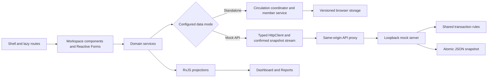
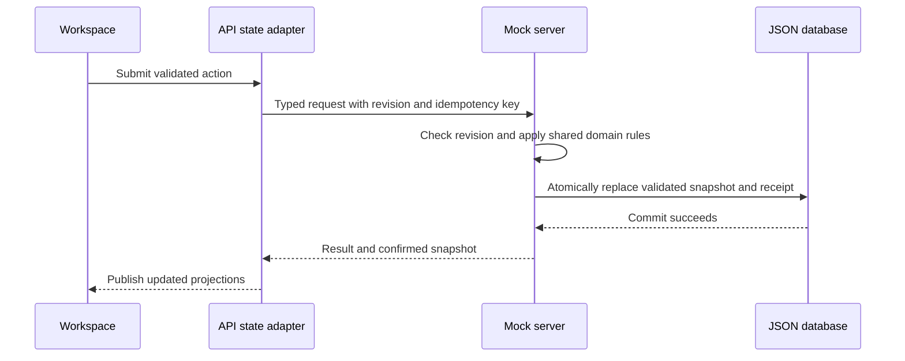

# BookSphere architecture

## Application boundaries

`AppModule` configures Angular routing, HTTP interception, and circulation initialization. `ShellComponent` provides the navigation, breadcrumb, mode indicator, and router outlet. `AppRoutingModule` lazy-loads Dashboard, Catalogue, Book Management, Members, Circulation, Reservations, Overdue, Reports, and Settings. Shared modules supply page headings, book and circulation dialogs, filters, and Material controls.

Domain models and validation live under `src/app/models` and `src/app/core`. Presentation components delegate changes to the book, member, circulation, reservation, fine, and settings services. Reactive Forms give immediate feedback. The domain layer repeats the validation at the transaction boundary. Analytics and reports consume projections of confirmed data. Neither writes operational records to generate a report.

## Standalone mode

The settings in the development and production environments select standalone mode. The circulation coordinator reads the v2 snapshot or applies an existing migration from v1 or legacy book inventory. Member data has its own key and membership ID counter. The shared lock coordinates circulation and member changes. Browsers with Web Locks can coordinate tabs. The fallback serializes writes within a tab.

Circulation operations check membership and settings, advance eligible reservations, apply the requested operation, recalculate stock, and persist one circulation snapshot before publishing it. The older demonstration allocations were released during migration because no loan or reservation records backed them. Active records govern inventory after migration. Existing date-only logic, fine snapshots, and integer paise preserve transaction semantics.

## Mock API mode

The API environment uses a relative `/api` base and Angular's development proxy. The mock listens on `127.0.0.1:3000`. The startup read hydrates a confirmed snapshot containing inventory, circulation, members, settings, and activity. Resource endpoints expose views from that snapshot. An API failure does not switch persistence modes.

The client serializes writes and shares identical requests while they are in flight. The server rejects stale revisions and can replay a retained idempotency receipt without reapplying the action. Failed validation or persistence leaves the last confirmed state in place. The HTTP interceptor maps network, timeout, and conflict failures to readable messages. The mode bar offers a safe read retry. Mutation failures require explicit resubmission.

## Tests and release limits

Jasmine covers domain rules, migrations, financial calculations, form and report behavior, the API adapter, and accessibility regressions. Karma executes the suite in ChromeHeadless. The Node HTTP integration suite exercises the mock with a disposable database, including restarts and a simulated persistence failure. The separate browser responsive sweep used isolated profiles. [QA results and manual checklist](phase-6-quality-assurance.md)

The server is a single-process development mock. The application has no authorization boundary for real library users. [Mock API setup and endpoints](../mock-api/README.md)
